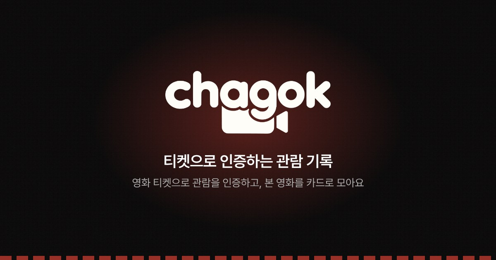
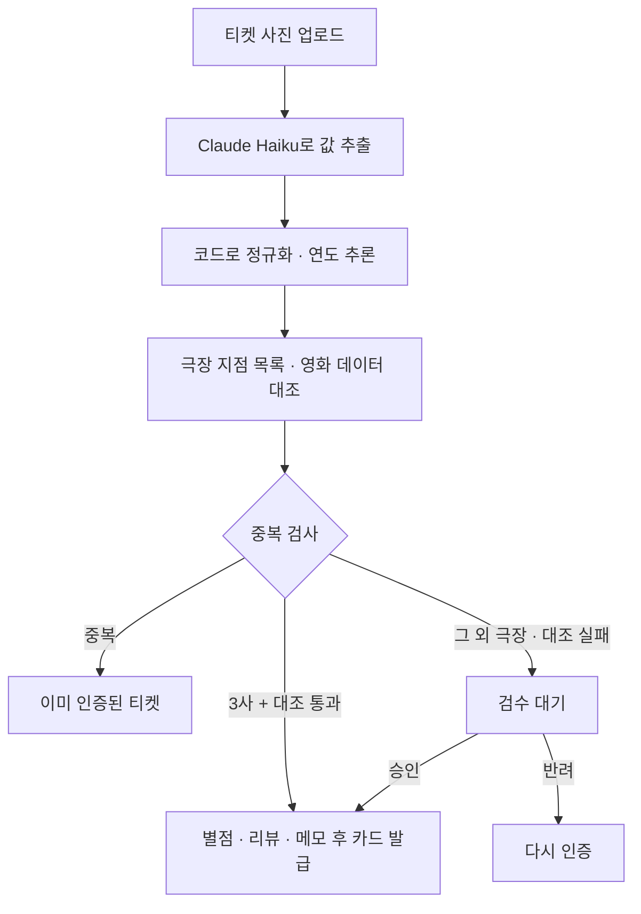

<p align="center">
  
</p>

# 차곡

영화 티켓으로 관람 인증하고, 본 영화를 카드로 모으는 아카이브

- 서비스: https://chagok-eight.vercel.app (모바일 웹 / PWA, 출시 전 개발 중)
- 기간: 2026.09 ~ 진행 중
- 인원: 2명. 기획 · 프론트엔드 · 백엔드 · 배포는 직접 하고, 화면 디자인은 디자이너가 맡음

## 왜 만들었나

요즘 영화는 "봤다"보다 "어디서, 어떤 관에서, 언제 봤냐"가 더 의미 있어짐
아이맥스, 돌비, 특별관, 재개봉 찾아다니는 사람도 많아졌는데 왓챠피디아나 레터박스드는 아직 "뭘 봤는지 + 별점"만 남김

여기서 문제라고 본 건 두 가지

- 기록에 무게가 없음: 별점은 그냥 입력한 숫자라 봤다는 증거가 안 됨. 진짜 증거인 티켓은 버려짐
- 평점을 못 믿음: 안 본 사람도 평점을 남길 수 있어서 별점 테러 · 조작이 계속 생김

둘 다 관람한 사실이랑 기록이 따로 놀아서 생기는 문제라고 봤고, 인증해야만 기록할 수 있게 만들기로 함

### 인증이 번거로운 건 일부러 그런 것

업로드 -> 기다림 -> 실패할 수도 있는 과정을 줄이려고 하지 않음
쉽게 얻으면 모을 이유가 없어서. 등산 정상 인증샷이나 스탬프 투어랑 같은 구조
대신 새 행동을 만들진 않고, 이미 하는 행동(티켓 사진 찍기)을 서비스 안으로 가져옴

### 인증 흐름은 디자이너랑 조율해서 정함

처음엔 의견이 갈렸음

- 디자이너: 영화 검색 -> 선택 -> 인증 (익숙한 흐름이라서)
- 개발: 티켓 업로드 -> 자동 인식 (인증이 서비스 핵심이라서)

두 흐름의 단계 수랑 이탈 지점을 같이 비교해 봤고, 티켓 먼저 흐름으로 가되 첫 화면에 촬영 가이드를 넣는 걸로 합의함

## 기능

- 티켓 인증: 종이 · 모바일 티켓 사진 한 장으로 인증. CGV · 롯데시네마 · 메가박스는 자동, 그 외 극장은 직접 검수 (24시간 안)
- 카드 발급: 인증하면 홀로그램 카드 발급, 인증번호(CHG-관람일-순번)가 붙음
- 관람 리뷰 · 별점: 인증한 사람만 남길 수 있음 -> 실제로 본 사람의 평점
- 컬렉션 · 카드 상세: 연도별로 모아 보기, 카드를 뒤집으면 나만 보는 메모
- 공유 이미지: 카드 + 영화 정보를 1080×1920 이미지로 저장 · 공유 (next/og)
- 랭킹: 매일 00:00 카드 수로 집계, 순위 변화 표시
- 홈: 내 카드, 이번 달 수집 현황, 인기 영화(KOBIS), 곧 개봉(TMDB)
- PWA: 앱 출시 없이 웹으로만 운영할 계획이라 홈 화면 추가 · iOS 스플래시까지 넣음

## 티켓 인증



정한 원칙

- 위조를 완벽히 막는 건 불가능 (극장 예매 조회 공개 API가 없음) -> 목표는 "위조 비용 > 카드 한 장 가치"
- 판정은 서버만 함. 클라이언트는 이미지만 보내고 영화 · 극장 · 좌석 값은 서버가 뽑음
- LLM은 값 추출만, 진짜인지는 규칙 코드가 판단 (이미지 속 "인증됨" 같은 문구에 안 속게)
- 안 보이는 값은 null로 받음 (없는 값 지어내기 방지). 필수 값이 null이면 검수로
- tickets 테이블은 사용자한테 select만 줌. insert · update는 서버만 -> 콘솔에서 status = 'verified'로 넣는 걸 RLS로 막음

## 해 보면서 바꾼 것들

실제 티켓 샘플(3사 × 종이 · 모바일)로 추출 비교 스크립트(`scripts/compare-extraction.mjs`)를 만들어 돌려 보고, 결과 보고 바꾼 것들

### 모델은 Haiku로

처음엔 5장으로 Haiku랑 Sonnet 비교

- Haiku: 장당 약 $0.0006, 5.9초
- Sonnet: 장당 약 $0.0067, 2.4초
- 상영일 · 시각 · 제목은 둘 다 전부 맞음

비용이 10배 가까이 차이 나서 14장으로 한 번 더 확인하고 Haiku로 확정
하다가 Haiku가 답하기 전에 생각 토큰을 많이 써서 max_tokens 1024에서 JSON이 잘리는 걸 발견 -> 4096으로 올리고, 잘리면 에러로 처리

### 중복은 예매번호 말고 좌석 단위로

처음엔 예매번호로 막으려 했는데 테스트해 보니 안 됨

- 롯데 종이 티켓엔 예매번호가 아예 없음
- 메가박스 종이 티켓 20자리 번호를 Haiku · Sonnet 둘 다 0 하나 빼고 19자리로 읽음
- Sonnet은 멤버십 관람권 번호를 예매번호 칸에 넣음

그래서 기본 지문을 체인 + 극장 + 상영일시 + 좌석으로 바꿈 (모든 티켓에 있고 짧아서 오독이 적음). 예매번호는 있을 때만 보조로

- 정규화는 LLM 말고 코드에서 함. 모델 · 실행마다 표기가 달라서 (E열 10, I-12, D열 9번 -> E10, I12, D9 / 연속 좌석 F열9-10번 -> F9, F10)
- 동시 요청은 DB unique 제약이 막고, 23505 에러를 "이미 인증된 티켓" 화면으로 연결
- 좌석 단위라 같이 예매한 친구는 같은 캡처로 나머지 좌석 인증 가능

### 확신도가 high여도 틀릴 수 있음

구겨진 종이 티켓에서 "역곡"을 "혁곡"으로 읽었는데 확신도는 high였음
-> 확신도만 믿지 않고 3사 공식 사이트 극장 목록(CGV 171 · 롯데 132 · 메가박스 110)이랑 대조, 목록에 있는 표준 이름으로만 지문을 만듦

- 비슷한 이름으로 맞추진 않음 (혁곡 -> 못 찾음 -> 검수)
- 폐관 지점(최근 17곳)이나 표기만 다른 지점은 별칭 목록에 추가 -> 한 번 검수하면 다음부터 자동 인증

### "티켓 맞아?" 대신 화면 종류를 고르게

같은 CGV 예매 상세 사진을 is_ticket true / false로 오락가락함
-> 예/아니오 대신 종류(paper_ticket · mobile_ticket · booking_detail · payment_history · other)를 고르게 하고, 구분 단서(QR · 바코드, 취소 기한 등)를 줌. 받을지는 코드가 정함

- 예매 상세 · 결제 내역은 예매를 취소해도 남아서 안 받음

### 모바일 티켓엔 연도가 없음

CGV "8/22(일)", 메가박스 "08.24 (토)"처럼 월일 · 요일만 있음
-> LLM은 월일 · 요일만 읽고 연도는 코드에서 정함. 오늘 이전에서 월일 · 요일이 맞는 해를 모은 다음 영화 개봉일로 고름

- 예: "돈"(2019-03-20 개봉) 3/23(토) -> 2024가 아니라 2019
- 애매하면 검수로

### 사진 크기 기준은 1000 -> 700 -> 400px

메신저로 받은 사진, 잘라낸 사진처럼 충분히 읽히는 진짜 티켓이 막혔음
AI 비용이 장당 약 $0.0007이라 아낄 이유가 약하고, 작은 사진 오독은 지점 · 영화 대조에서 걸려서 검수로 감 -> 짧은 변 400px 미만만 막는 걸로 완화
구겨진 티켓 오독 이후로는 촬영 안내에 "펴서 찍기"도 추가함

## DB

- 스키마는 Supabase CLI 마이그레이션으로만 바꿈 (SQL Editor에서 테이블 안 건드림)
- 새 테이블은 RLS + 정책 + grant 같이
- 같이 바뀌어야 하는 건 DB 함수 하나로 묶음
  - issue_card: 티켓 확정 + 관람평 + 카드를 한 트랜잭션으로
  - approve_ticket / reject_ticket: 상태 변경 + 알림 생성 + (반려면) 지문 해제. 대시보드에서 컬럼만 바꾸면 알림이 안 생겨서
  - refresh_rankings: 매일 00:00(KST) 기준 집계. Vercel Hobby라 cron이 최대 1시간 늦을 수 있어서 기준 시각은 함수에서 고정

## 기술 스택

- Next.js 16 (App Router), React 19 + React Compiler, TypeScript
- Tailwind CSS v4 (Figma 변수를 그대로 토큰으로), cva
- react-hook-form + Zod 4 (스키마는 클라이언트 · 서버 같이 씀), Zustand
- Supabase (Auth, Postgres, RLS, Storage), Server Actions, Route Handlers
- Claude API (Haiku, 구조화 출력)
- KOBIS 오픈API, TMDB
- Vercel (배포, Cron), Discord 웹훅 (검수 요청 알림)
- Biome

## Claude Code 작업 환경

Claude Code로 같이 작업해서, 규칙이랑 맥락을 저장소에 넣어 둠

- CLAUDE.md: 매번 지킬 것만 (명령어, 코드 · 스타일 규칙, 하지 말 것, 지금 상태)
- .claude/docs/: 기획 · 티켓 인증 · 디자인 시스템 · DB · 로그인 · 인프라 문서. 결정한 것과 이유를 날짜랑 같이 적어 둠
- Stop hook: 작업 끝낼 때 tsc + Biome 검사, 실패하면 고치고 다시 끝내게 함
- pre-commit hook: 커밋할 때 Biome 자동 수정, 못 고치는 에러면 커밋 막음
- db push, git push(main push = 바로 배포)는 먼저 물어보게 함

## 폴더 구조

```
src/
├── app/
│   ├── (auth)/      로그인 · 회원가입
│   ├── (main)/      홈 · 컬렉션 · 랭킹 · 마이
│   ├── (detail)/    카드 상세
│   ├── (sub)/       프로필 편집 · 알림 · 설정
│   ├── verify/      티켓 인증 단계별 화면
│   └── api/         티켓 인식 · 공유 이미지 · cron
├── components/      공통 컴포넌트
├── lib/
│   ├── ticket/      추출 · 정규화 · 지점 대조 · 영화 매칭
│   ├── movies/      KOBIS · TMDB
│   ├── card-image/  공유 이미지
│   └── supabase/    클라이언트 · proxy
└── constants/       3사 극장 목록 등
supabase/migrations/ DB 스키마
```

## 진행 상황

끝난 것

- 이메일 가입 · 로그인, 소셜 로그인(구글 · 카카오) 코드 연결
- 티켓 인증 (인식 · 3사 지점 대조 · 확인 요청 · 검수 승인/반려 · 카드 발급)
- 홈 · 컬렉션 · 카드 상세 · 랭킹 실데이터
- 공유 이미지 저장 · 공유
- 마이 · 프로필 편집, 다크 테마, 반응형 (모바일 · 태블릿 · 데스크톱)
- PWA

남은 것

- 카드 삭제 · 관람평 수정
- 알림 · 공지 데이터 연결
- 비밀번호 찾기, 소셜 로그인 실제 테스트
- 출시 직후: 특별관(상영관) 대조, 같은 사진 재업로드 차단(pHash), 인증 횟수 제한

## 실행

```bash
npm install
cp .env.example .env.local   # Supabase · Anthropic · KOBIS · TMDB 키, CRON_SECRET, DISCORD_WEBHOOK_URL
npm run dev
```

```bash
npm run lint      # biome check
npm run format    # biome check --write
npx tsc --noEmit
```

---

영화 데이터: [KOBIS](https://www.kobis.or.kr), [TMDB](https://www.themoviedb.org)
This product uses the TMDB API but is not endorsed or certified by TMDB.
